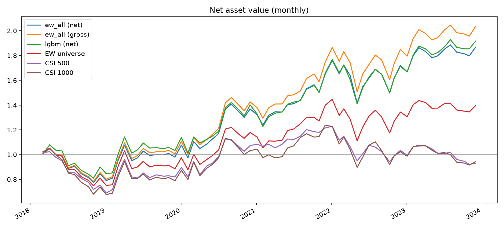
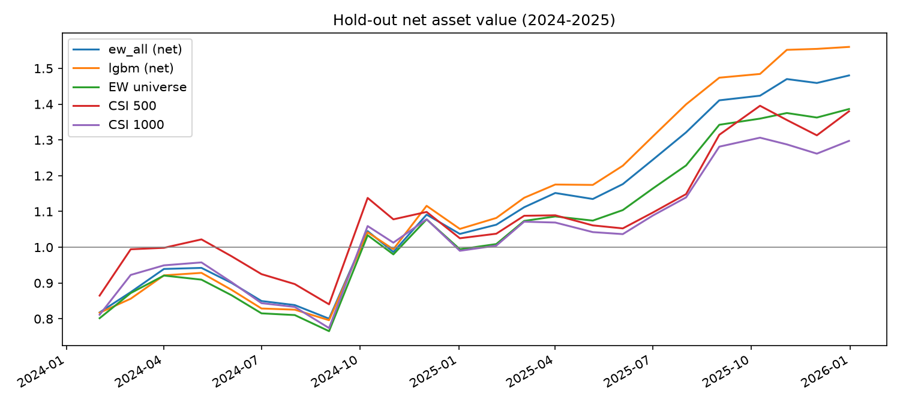
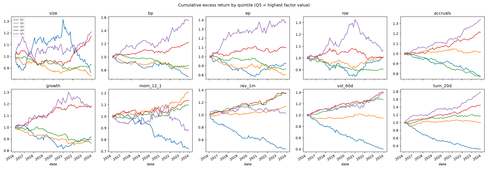

# A-Share Multi-Factor Stock Selection and Backtest

An end-to-end factor research project on China A-shares using only free data: data cleaning, point-in-time
fundamentals, factor construction and testing, factor combination (equal weight, linear regression, LightGBM),
and a long-only monthly backtest with trading costs and A-share trading limits. All research choices were fixed
on 2016-2023 data; 2024-2025 was held out and evaluated once at the end.

## Results at a glance

Long-only strategy, top 20% of stocks by combined score, rebalanced monthly, **net of costs**.

| | 2018-2023 (in-sample) | 2024-2025 (hold-out, run once) |
|---|---|---|
| Strategy (equal-weight score) annualized return | 11.30% | 21.67% |
| Equal-weighted universe | 5.88% | 17.74% |
| CSI 500 (price index) | -1.23% | 17.48% |
| CSI 1000 (price index) | -1.02% | 13.90% |
| Information ratio vs. equal-weighted universe | 1.14 | 0.42 |
| Max drawdown (monthly data) | -26.01% | -15.06% |
| Average monthly one-way turnover | 35.45% | 36.17% |

LightGBM combination, same rules: 11.79% (2018-2023) and 24.90% (2024-2025).




## Data

- **Universe:** 5,415 Shanghai/Shenzhen A-shares (main boards, ChiNext, STAR) with prices from 2014-01-02 to
  2025-12-31, including **all 253 stocks delisted** in the period (survivorship-bias free). Beijing Stock
  Exchange and B-shares excluded.
- **Sources (AkShare):** Sina for listed stocks, Tencent for delisted stocks, Eastmoney for financial
  statements, Shenwan (SWS) 2021 industry history, Sina for indices. Downloads use rate limiting, retries,
  cool-downs and source fallback.
- **Unit checks:** volume is reported in lots by some sources; `amount / (volume x close)` is checked to be
  close to 1 for every source.
- **Adjusted-price validation:** cross-checking the same stocks across sources showed that Tencent's adjusted
  prices are affine in raw prices (`adj = a x raw + b`, splits change `a`, cash dividends change `b`), which
  compresses percentage returns. For Vanke (000002) the 2014-2025 cumulative return was +56.79% from that
  series versus -9.52% from Sina. Returns were rebuilt from the series' structure; on three test stocks the
  rebuilt cumulative returns match Sina within 0.84 percentage points (`scripts/03_compare_sources.py`).
- **Point-in-time fundamentals:** the free data's "latest announcement date" had median lags of 393-478
  days after period end, i.e. an update date, not a first disclosure date. Rule used: for Q1/H1/Q3 reports, the balance-sheet
  table's announcement date when it is no later than the statutory deadline; otherwise, and for all annual
  reports, the statutory deadline (Apr 30, Aug 31, Oct 31, Apr 30 of the next year). A report is used only
  on rebalance dates strictly after that date (`scripts/06_check_announcements.py`).

## Factors

Ten factors, each multiplied by a sign fixed **before** testing (`config.py`):

| Factor | Definition | Prior sign |
|---|---|---|
| size | log float market cap (amount / turnover) | - |
| bp | book value per share / price, in report-date share units | + |
| ep | TTM ROE x BP (= TTM earnings / market value) | + |
| roe | TTM net profit / equity | + |
| accruals | (TTM net profit - TTM operating cash flow) / total assets | - |
| growth | latest reported YoY net profit growth | + |
| mom_12_1 | return from 12 months to 1 month ago | + |
| rev_1m | last-month return | - |
| vol_60d | 60-day volatility of daily returns | - |
| turn_20d | 20-day average turnover | - |

Cross-sectional preprocessing on each month-end: MAD winsorization (median +/- 3 x 1.4826 x MAD), industry
median fill, z-score, OLS neutralization on Shenwan level-1 industry dummies and size, z-score again.
Universe filters: at least 120 trading days of history, traded on the rebalance day, and an ST proxy
(negative equity or two consecutive annual losses).

## Single-factor tests (2016-2023, 95 months)

Pass rule fixed in advance: mean Rank IC >= 0.02, t >= 2, top-minus-bottom quintile return > 0.

| Factor | Rank IC | ICIR | t | Q5-Q1 annualized (before costs) | Pass |
|---|---|---|---|---|---|
| turn_20d | 0.0995 | 0.98 | 9.60 | 23.13% | yes |
| vol_60d | 0.0939 | 0.80 | 7.78 | 15.95% | yes |
| bp | 0.0530 | 0.54 | 5.26 | 10.03% | yes |
| rev_1m | 0.0489 | 0.51 | 4.96 | 10.15% | yes |
| ep | 0.0369 | 0.52 | 5.09 | 5.01% | yes |
| accruals | 0.0209 | 0.51 | 5.01 | 7.07% | yes |
| growth | 0.0090 | 0.14 | 1.36 | 2.97% | no |
| roe | 0.0079 | 0.09 | 0.89 | 0.44% | no |
| size | 0.0067 | 0.04 | 0.42 | 3.18% | no |
| mom_12_1 | -0.0047 | -0.05 | -0.44 | 2.17% | no |

Hold-out Rank IC for every factor: `reports/holdout_factor_ic.csv`.



## Factor combination (predictions for 2018-2023)

Target: cross-sectional percentile rank of next-month return. Linear regression and LightGBM use all 10
factors, trained on an expanding window of months strictly before each prediction date, refit every 12
months; LightGBM parameters were fixed in advance and the last 12 training months are used only for early
stopping.

| Method | Rank IC | ICIR | Q5-Q1 annualized (before costs) |
|---|---|---|---|
| Equal weight, 6 passed factors* | 0.1012 | 0.87 | 18.94% |
| Equal weight, all 10 factors | 0.0916 | 1.03 | 20.13% |
| Linear regression | 0.1039 | 0.98 | 20.04% |
| LightGBM | 0.1067 | 0.93 | 21.76% |

\*Selected on the same period, so optimistic. The backtest uses the all-factor equal weight as the main signal.
In the hold-out, Rank IC was 0.0909 (equal weight) and 0.1153 (LightGBM).

## Backtest rules

- Signal at the month-end close; trades at the **next trading day's close**.
- No buying at limit-up or while suspended; no selling at limit-down or while suspended (the position is
  carried); stocks that stop trading for good are sold at their last price.
- Costs per side: commission 0.025% + slippage 0.10%; stamp duty on sells 0.10%, 0.05% from 2023-08-28.
- Equal weight across the top 20% (about 776 holdings on average in 2018-2023).

## Limitations

- Long-only, so returns carry market risk; Sharpe ratio is 0.59 in 2018-2023 (equal-weighted universe: 0.36).
- Many small holdings: real capacity and market impact are not modeled beyond a flat slippage.
- No free historical ST flags or total share counts: ST is approximated; EP is computed as ROE x BP, with
  ROE on a total-equity basis.
- Financial values are the vendor's latest versions, which may include later restatements.
- Index benchmarks are price indices without dividends, which slightly favors the strategy; the equal-weighted
  universe (dividend-adjusted) is the main comparison.
- Rebuilt adjusted prices for delisted stocks can miss very small dividends on stocks priced under about 1 yuan.
- Drawdowns are measured on monthly data and understate intra-month drawdowns.
- The hold-out covers only 24 months.

## Project structure

```
config.py                 all research settings, fixed before testing
src/data/                 download, source fallback, adjusted-price rebuild, point-in-time fundamentals
src/factors/              factor construction and cross-sectional preprocessing
src/evaluation/           IC, Rank IC, quintile tests
src/models/               equal weight, linear regression, LightGBM walk-forward
src/backtest/             monthly backtest engine with costs and trading limits
scripts/                  numbered entry points (run in order)
reports/                  result tables and figures
```

## How to run

```bash
pip install -r requirements.txt
python scripts/01_download_data.py --step reference
python scripts/01_download_data.py --step financials
python scripts/01_download_data.py --step listed
python scripts/01_download_data.py --step delisted --sources tx,em
python scripts/05_fix_tx_hfq.py
python scripts/10_build_factors.py
python scripts/20_factor_tests.py
python scripts/30_combine_factors.py
python scripts/40_backtest.py
python scripts/50_holdout.py
```

The Shenwan industry file may need to be downloaded manually into `data/raw/manual/` if the site's
certificate fails verification in Python (see `src/data/reference.py`). Full price downloads take several
hours because the free sources throttle requests.
